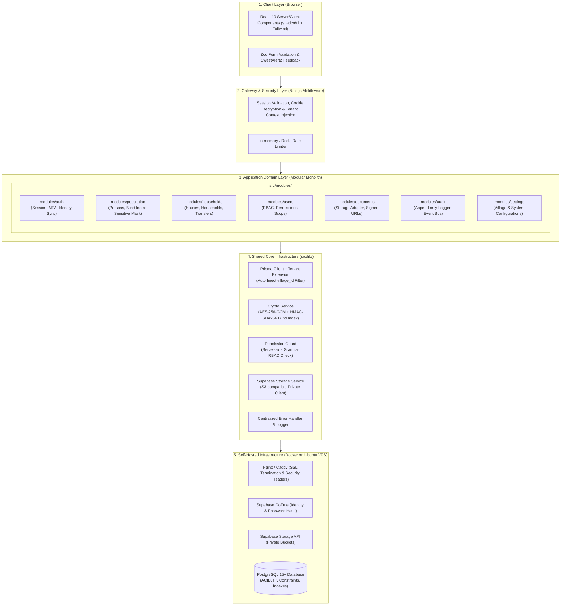
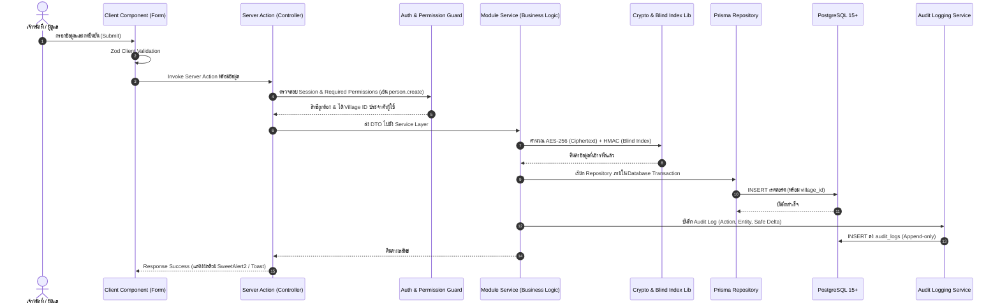

# สถาปัตยกรรมระบบ (System Architecture Specification)
## Smart Village Management System (VMS) — ระบบบริหารหมู่บ้านอัจฉริยะ

---

## 1. ภาพรวมสถาปัตยกรรม (Architecture Overview)

ระบบ **Smart Village Management System (VMS)** ถูกออกแบบเป็น **Modular Monolith Platform** บน **Next.js 16 (App Router)** ร่วมกับ **TypeScript (Strict Mode)**, **Prisma ORM**, และ **Supabase Self-hosted Suite** (GoTrue Auth, Storage Engine, PostgreSQL 15+) บนระบบปฏิบัติการ Ubuntu VPS ทำหน้าที่เป็นศูนย์กลางรวบรวมหลากหลายระบบงานของชุมชนเข้าไว้ด้วยกันในแพลตฟอร์มเดียว

แนวคิดสำคัญของสถาปัตยกรรมนี้คือ:
- **Unified Multi-System Hub**: รวบรวมงานทะเบียนประชากร ผังบ้าน ครัวเรือน คลังเอกสาร และสิทธิ์ไว้ในแกนกลางเดียวกัน พร้อมโครงสร้างแบบ Plug-and-Play สำหรับเชื่อมต่อระบบงานหมู่บ้านในอนาคต
- **Simple to Deploy & Operate**: รวมการประมวลผล Frontend และ Backend API ไว้ในชุดเดียว เหมาะสมกับ VPS ทรัพยากรจำกัด แต่แยกส่วนตรรกะภายในอย่างเป็นระเบียบ
- **Strict Boundary & Isolation**: แบ่งโค้ดตาม Business Domain ในไดเรกทอรี `src/modules/` ทำให้แต่ละโมดูลเป็นอิสระต่อกัน ลด Coupling และป้องกัน Spaghetti Code
- **Tenant Isolation**: บังคับใช้บริบทหมู่บ้าน (`village_id`) ผ่าน Prisma Client Extensions และ Service-level Guards ป้องกันปัญหา Cross-tenant Data Leakage

---

## 2. แผนภาพสถาปัตยกรรมระดับสูง (High-Level Architecture Diagram)



---

## 3. โครงสร้างไดเรกทอรีโครงการ (Project Structure)

```
vms/
├── .github/                  # CI/CD Workflows
├── docker/                   # Docker Compose & Nginx configs for Self-hosted VPS
├── docs/                     # สถาปัตยกรรมและคู่มือระบบ (12 ฉบับ)
├── prisma/                   # Prisma Schema & Migrations
│   ├── schema.prisma         # Single source of truth for DB Schema
│   └── seed.ts               # Initial Seed (System Roles & Permissions)
├── public/                   # Static assets (Favicons, logos)
├── src/
│   ├── app/                  # Next.js 16 App Router (Page views & Layouts)
│   │   ├── (auth)/           # Route group: Login, Forgot Password
│   │   ├── (dashboard)/      # Route group: Protected Pages (Main Layout)
│   │   │   ├── dashboard/
│   │   │   ├── populations/
│   │   │   ├── houses/
│   │   │   ├── users/
│   │   │   ├── roles/
│   │   │   ├── documents/
│   │   │   ├── audit-logs/
│   │   │   └── settings/
│   │   ├── api/              # Route Handlers for External/Webhook/File Stream
│   │   ├── layout.tsx
│   │   └── page.tsx
│   ├── components/           # Shared UI Components
│   │   ├── ui/               # shadcn/ui primitive components (Button, Dialog, etc.)
│   │   ├── layout/           # Header, Sidebar, UserMenu, TenantSwitcher
│   │   └── feedback/         # SweetAlert2 wrappers, Toast notifications
│   ├── modules/              # Core Business Domains (Modular Monolith)
│   │   ├── auth/             # Authentication & Session domain
│   │   ├── population/       # Person, Encryption & Blind Index domain
│   │   ├── households/       # House, Household, Membership & Transfer domain
│   │   ├── users/            # User management domain
│   │   ├── roles/            # Roles & Dynamic RBAC Registry domain
│   │   ├── documents/        # File & Supabase Storage management domain
│   │   ├── audit/            # Activity & Security Audit Logging domain
│   │   ├── dashboard/        # Aggregated Reporting & Read-Model domain
│   │   └── settings/         # Village & System Settings domain
│   ├── lib/                  # Shared Core Utilities
│   │   ├── prisma.ts         # Extended Prisma Client instance
│   │   ├── crypto.ts         # AES-256-GCM and HMAC Blind Index utilities
│   │   ├── auth.ts           # Supabase Auth Server Session Helpers
│   │   ├── permissions.ts    # RBAC verification helpers (assertPermission)
│   │   ├── formatters.ts     # Thai ID, Phone, Currency & File Size formatters
│   │   ├── date-utils.ts     # Thai Age calculation and date formatting utilities
│   │   ├── storage.ts        # Supabase Storage S3 client wrapper
│   │   ├── exceptions.ts     # Custom Application Exceptions
│   │   └── utils.ts          # Generic helper functions (cn)
│   ├── config/               # Application & Environment configuration
│   └── types/                # Global TypeScript definitions
├── tests/                    # Automated Test Suites
│   ├── unit/                 # Unit tests (Vitest)
│   ├── integration/          # Integration tests (Vitest)
│   └── e2e/                  # End-to-End tests (Playwright)
├── AGENTS.md                 # คำแนะนำและกฎการทำงานสำหรับ AI Agents
├── package.json
└── tsconfig.json
```

---

## 4. โครงสร้างภายในแต่ละโมดูล (Module Internal Pattern)

เพื่อรักษาความสม่ำเสมอ ทุกโมดูลภายใต้ `src/modules/<module-name>/` จะมีโครงสร้างดังนี้:

```
src/modules/<module-name>/
├── types.ts          # Domain-specific Types & Interfaces
├── schemas.ts        # Zod Validation Schemas (Input/Output contracts)
├── repository.ts     # Data Access Layer (Prisma Queries with Tenant Context)
├── service.ts        # Business Logic & Rules (Pure domain logic)
├── actions.ts        # Next.js Server Actions (Controller layer invoked by UI)
└── __tests__/        # Module-specific unit & integration tests
```

### กฎความสัมพันธ์ระหว่างโมดูล (Module Dependency Rules):
1. **No Circular Dependencies**: โมดูล A ห้ามเรียกโมดูล B หากโมดูล B มีการเรียกโมดูล A
2. **Domain Encapsulation**: โมดูลภายนอกต้องติดต่อผ่าน `service.ts` หรือ `actions.ts` เท่านั้น ห้ามเรียก `repository.ts` ของโมดูลอื่นโดยตรง
3. **Cross-Domain Events via Audit / Dispatcher**: เมื่อเกิดเหตุการณ์ข้ามโมดูล (เช่น บุคคลถูกลบ ให้เอกสารที่เกี่ยวข้องถูกทำเครื่องหมาย) ให้ทำงานผ่าน Service Orchestration หรือ Transaction Block ที่ควบคุมอย่างชัดเจน

---

## 5. กระแสข้อมูลและการประมวลผล (Data Flow & Execution Pattern)



---

## 6. การตัดสินใจเชิงสถาปัตยกรรม (Architectural Decision Records - ADR)

### ADR-01: การเลือกใช้ Next.js 16 Modular Monolith แทน Microservices
- **บริบท**: ระบบเริ่มต้นใช้งานกับ 1 หมู่บ้าน และขยายสู่หลายหมู่บ้านบน Single VPS
- **การตัดสินใจ**: ใช้ Next.js 16 App Router รวม Frontend และ Backend Logic ไว้ด้วยกัน แยก Domain ด้วย Modular Monolith
- **ผลลัพธ์**: ดูแลรักษาง่าย ประหยัดแรม (ต่ำกว่า 512MB สำหรับ Node.js process) ลด Overhead ในการทำ Network serialization ขยายระบบได้รวดเร็ว

### ADR-02: การแบ่งแยก Supabase Auth ออกจาก Application Database Users
- **บริบท**: Supabase Auth เก็บข้อมูล Identity, Passwords, Refresh Tokens ในตาราง `auth.users`
- **การตัดสินใจ**: ไม่สร้างตารางเก็บ Password ซ้ำใน Application schema แต่สร้างตาราง `users` ใน Public schema โดยมี Primary Key เป็น `id UUID REFERENCES auth.users(id)`
- **ผลลัพธ์**: ได้ความปลอดภัยระดับสากลจาก GoTrue (Bcrypt/Argon2, Refresh Token Rotation, MFA) โดยไม่ต้องกังวลเรื่องการจัดการรหัสผ่านเอง

### ADR-03: การบังคับใช้ Multi-Village Isolation ผ่าน Prisma Extension
- **บริบท**: ป้องกันไม่ให้ Developer หรือ AI ลืมใส่ `where: { villageId }` ในคำสั่งค้นหา
- **การตัดสินใจ**: ใช้ Prisma Client Extensions กำหนด `$allOperations` ให้ตรวจสอบและแทรกเงื่อนไข Tenant Filter อัตโนมัติในทุก Query ที่เกี่ยวข้องกับข้อมูลประชากรและครัวเรือน
- **ผลลัพธ์**: ป้องกัน IDOR และ Cross-Village Data Leakage ในระดับโครงสร้างพื้นฐาน

### ADR-04: การคุ้มครองเลขบัตรประชาชนด้วย Field-Level Encryption + Blind Index
- **บริบท**: เลขบัตรประชาชน 13 หลักเป็นข้อมูลส่วนบุคคลอ่อนไหวสูง แต่จำเป็นต้องค้นหาแบบ Exact Match ได้อย่างรวดเร็ว
- **การตัดสินใจ**:
  - เก็บค่า Ciphertext ที่เข้ารหัสด้วย AES-256-GCM สำหรับการถอดรหัสมาแสดงผล (เฉพาะผู้มีสิทธิ์)
  - เก็บค่า HMAC-SHA256 (Blind Index พร้อม Pepper ลับ) ในคอลัมน์ `national_id_bindex` พร้อมสร้าง Unique Index
- **ผลลัพธ์**: ฐานข้อมูลไม่มี Plaintext เลขบัตรประชาชน หากฐานข้อมูลรั่วไหล ผู้โจมตีจะไม่สามารถอ่านเลขบัตรได้ และยังคงค้นหาข้อมูลได้อย่างรวดเร็วในระดับ $O(1)$ ผ่าน B-Tree Index
