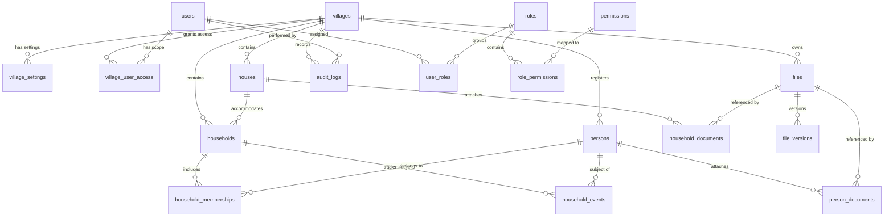

# สถาปัตยกรรมฐานข้อมูลและแบบจำลองข้อมูล (Database Architecture & Data Dictionary)
## Smart Village Management System (VMS) — ระบบบริหารหมู่บ้านอัจฉริยะ

---

## 1. ภาพรวมสถาปัตยกรรมฐานข้อมูล (Database Overview)

ฐานข้อมูลของระบบ VMS พัฒนาบน **PostgreSQL 15+** ผ่านการบริหารจัดการสคีมาด้วย **Prisma ORM (Prisma Schema & Prisma Migrate)** 

หลักการออกแบบฐานข้อมูล:
1. **UUID Primary Keys**: ทุกตารางใช้ UUID v4 เป็น Primary Key ป้องกันการคาดเดา ID (Sequential ID Enumeration Attacks)
2. **Referential & Relational Integrity**: ใช้ Foreign Key Constraints ควบคุมความสัมพันธ์อย่างเข้มงวด พร้อมเลือก `RESTRICT` หรือ `CASCADE` ตามบริบทความปลอดภัย
3. **Multi-Village Scoping**: ทุกตารางที่เก็บข้อมูลทางธุรกิจมีคอลัมน์ `village_id UUID NOT NULL` พร้อม Index
4. **Field-Level Encryption & Blind Indexing**: คอลัมน์เลขประจำตัวประชาชนจัดเก็บเป็น `national_id_encrypted` (AES-256-GCM) และ `national_id_bindex` (HMAC-SHA256) โดยมี Unique Constraint
5. **Append-Only Immutability**: ตาราง `audit_logs`, `security_events`, และ `household_events` ถูกออกแบบให้อ่านและเพิ่มได้เท่านั้น (ไม่มี Update/Delete)

---

## 2. แผนภาพความสัมพันธ์ของเอนทิตี (Entity-Relationship Diagram)

---

## 3. พจนานุกรมข้อมูล (Data Dictionary)

### 3.1 กลุ่ม Identity, Users & Access Control

#### ตาราง: `users`
เชื่อมโยงกับ `auth.users` ของ Supabase
| ชื่อฟิลด์ | ชนิดข้อมูล | Nullable | ค่าเริ่มต้น | ดัชนี / ข้อจำกัด | คำอธิบาย |
|:---|:---|:---:|:---:|:---|:---|
| `id` | UUID | NO | - | PK, FK -> `auth.users(id)` ON DELETE RESTRICT | รหัสผู้ใช้ตรงกับ Supabase Auth |
| `email` | VARCHAR(255) | NO | - | UNIQUE | อีเมลผู้ใช้งาน |
| `full_name` | VARCHAR(150) | NO | - | - | ชื่อ-นามสกุลเจ้าหน้าที่ |
| `phone_number` | VARCHAR(20) | YES | NULL | - | เบอร์โทรศัพท์ติดต่อ |
| `avatar_url` | TEXT | YES | NULL | - | รูปภาพโปรไฟล์ |
| `is_active` | BOOLEAN | NO | true | INDEX | สถานะการเปิดใช้งานบัญชี |
| `security_pin_hash` | VARCHAR(255) | YES | NULL | - | แฮชรหัสผ่าน 6 หลักเฉพาะบุคคล (PBKDF2-HMAC-SHA512) |
| `security_pin_salt` | VARCHAR(64) | YES | NULL | - | Salt สุ่ม 32-byte ประจำตัวผู้ใช้ |
| `pin_failed_attempts` | INT | NO | 0 | - | จำนวนครั้งที่กรอก PIN ผิดสะสม |
| `pin_locked_until` | TIMESTAMPTZ | YES | NULL | - | วันเวลาที่ถูกระงับสิทธิ์ชั่วคราวกรณีใส่ผิดเกินกำหนด |
| `created_at` | TIMESTAMPTZ | NO | now() | - | วันเวลาที่สร้างบัญชี |
| `updated_at` | TIMESTAMPTZ | NO | now() | - | วันเวลาที่แก้ไขล่าสุด |

#### ตาราง: `roles`
| ชื่อฟิลด์ | ชนิดข้อมูล | Nullable | ค่าเริ่มต้น | ดัชนี / ข้อจำกัด | คำอธิบาย |
|:---|:---|:---:|:---:|:---|:---|
| `id` | UUID | NO | gen_random_uuid() | PK | รหัสบทบาท |
| `name` | VARCHAR(50) | NO | - | UNIQUE | ชื่อบทบาท (เช่น SYSTEM_ADMIN, VILLAGE_ADMIN) |
| `display_name` | VARCHAR(100) | NO | - | - | ชื่อแสดงผลภาษาไทย |
| `description` | TEXT | YES | NULL | - | คำอธิบายหน้าที่ของบทบาท |
| `is_system` | BOOLEAN | NO | false | - | เป็น System Role ที่ห้ามลบหรือไม่ |
| `created_at` | TIMESTAMPTZ | NO | now() | - | วันเวลาที่สร้าง |

#### ตาราง: `permissions`
| ชื่อฟิลด์ | ชนิดข้อมูล | Nullable | ค่าเริ่มต้น | ดัชนี / ข้อจำกัด | คำอธิบาย |
|:---|:---|:---:|:---:|:---|:---|
| `id` | UUID | NO | gen_random_uuid() | PK | รหัสสิทธิ์ |
| `code` | VARCHAR(100) | NO | - | UNIQUE | รหัสสิทธิ์ (เช่น person.create, audit.read) |
| `module` | VARCHAR(50) | NO | - | INDEX | กลุ่มโมดูล (population, household, user ฯลฯ) |
| `description` | VARCHAR(255) | NO | - | - | คำอธิบายสิทธิ์การใช้งาน |

#### ตาราง: `role_permissions`
| ชื่อฟิลด์ | ชนิดข้อมูล | Nullable | ค่าเริ่มต้น | ดัชนี / ข้อจำกัด | คำอธิบาย |
|:---|:---|:---:|:---:|:---|:---|
| `role_id` | UUID | NO | - | PK, FK -> `roles(id)` ON DELETE CASCADE | รหัสบทบาท |
| `permission_id`| UUID | NO | - | PK, FK -> `permissions(id)` ON DELETE CASCADE | รหัสสิทธิ์ |

#### ตาราง: `user_roles`
| ชื่อฟิลด์ | ชนิดข้อมูล | Nullable | ค่าเริ่มต้น | ดัชนี / ข้อจำกัด | คำอธิบาย |
|:---|:---|:---:|:---:|:---|:---|
| `user_id` | UUID | NO | - | PK, FK -> `users(id)` ON DELETE CASCADE | รหัสผู้ใช้งาน |
| `role_id` | UUID | NO | - | PK, FK -> `roles(id)` ON DELETE CASCADE | รหัสบทบาท |

#### ตาราง: `village_user_access`
กำหนดขอบเขตว่าผู้ใช้คนใดมีสิทธิ์เข้าถึงหมู่บ้านใด
| ชื่อฟิลด์ | ชนิดข้อมูล | Nullable | ค่าเริ่มต้น | ดัชนี / ข้อจำกัด | คำอธิบาย |
|:---|:---|:---:|:---:|:---|:---|
| `id` | UUID | NO | gen_random_uuid() | PK | รหัสการมอบสิทธิ์ |
| `user_id` | UUID | NO | - | FK -> `users(id)` ON DELETE CASCADE | ผู้ใช้งาน |
| `village_id` | UUID | NO | - | FK -> `villages(id)` ON DELETE CASCADE | หมู่บ้านที่อนุญาต |
| `is_default` | BOOLEAN | NO | false | - | เป็นหมู่บ้านเริ่มต้นเมื่อเข้าสู่ระบบ |
| - | - | - | - | UNIQUE(`user_id`, `village_id`) | 1 ผู้ใช้มีสิทธิ์ใน 1 หมู่บ้านได้ครั้งเดียว |

---

### 3.2 กลุ่ม Village & Settings

#### ตาราง: `villages`
| ชื่อฟิลด์ | ชนิดข้อมูล | Nullable | ค่าเริ่มต้น | ดัชนี / ข้อจำกัด | คำอธิบาย |
|:---|:---|:---:|:---:|:---|:---|
| `id` | UUID | NO | gen_random_uuid() | PK | รหัสหมู่บ้าน |
| `code` | VARCHAR(20) | NO | - | UNIQUE | รหัสหมู่บ้าน (เช่น V-010101) |
| `name` | VARCHAR(150) | NO | - | - | ชื่อหมู่บ้าน (เช่น บ้านหนองหญ้าขาว) |
| `moo` | INT | NO | 0 | - | หมู่ที่ |
| `subdistrict` | VARCHAR(100) | NO | - | - | ตำบล |
| `district` | VARCHAR(100) | NO | - | - | อำเภอ |
| `province` | VARCHAR(100) | NO | - | - | จังหวัด |
| `postal_code` | VARCHAR(10) | NO | - | - | รหัสไปรษณีย์ |
| `phone_number` | VARCHAR(30) | YES | NULL | - | เบอร์ติดต่อสำนักงานหมู่บ้าน |
| `logo_url` | TEXT | YES | NULL | - | ลิงก์ตราสัญลักษณ์หมู่บ้าน |
| `is_active` | BOOLEAN | NO | true | INDEX | สถานะเปิดใช้งาน |
| `created_at` | TIMESTAMPTZ | NO | now() | - | วันเวลาที่สร้าง |
| `updated_at` | TIMESTAMPTZ | NO | now() | - | วันเวลาที่แก้ไขล่าสุด |

#### ตาราง: `village_settings`
| ชื่อฟิลด์ | ชนิดข้อมูล | Nullable | ค่าเริ่มต้น | ดัชนี / ข้อจำกัด | คำอธิบาย |
|:---|:---|:---:|:---:|:---|:---|
| `id` | UUID | NO | gen_random_uuid() | PK | รหัสการตั้งค่า |
| `village_id` | UUID | NO | - | FK -> `villages(id)` ON DELETE CASCADE | หมู่บ้านที่เกี่ยวข้อง |
| `setting_key` | VARCHAR(100) | NO | - | - | คีย์การตั้งค่า |
| `setting_value`| JSONB | NO | - | - | ค่าการตั้งค่าในรูปแบบ JSON |
| - | - | - | - | UNIQUE(`village_id`, `setting_key`) | คีย์ต้องไม่ซ้ำในหมู่บ้านเดียวกัน |

---

### 3.3 กลุ่ม Population (ข้อมูลประชากร)

#### ตาราง: `persons`
| ชื่อฟิลด์ | ชนิดข้อมูล | Nullable | ค่าเริ่มต้น | ดัชนี / ข้อจำกัด | คำอธิบาย |
|:---|:---|:---:|:---:|:---|:---|
| `id` | UUID | NO | gen_random_uuid() | PK | รหัสบุคคลภายใน |
| `village_id` | UUID | NO | - | FK -> `villages(id)` ON DELETE RESTRICT, INDEX | หมู่บ้านที่ขึ้นทะเบียน |
| `person_code` | VARCHAR(30) | NO | - | UNIQUE | รหัสรันประชากร (เช่น P-2026-00001) |
| `national_id_encrypted` | TEXT | NO | - | - | เลขบัตรประชาชนเข้ารหัส AES-256-GCM |
| `national_id_bindex` | VARCHAR(64) | NO | - | UNIQUE, INDEX | Blind Index (HMAC-SHA256) ค้นหาเลขบัตร |
| `national_id_masked` | VARCHAR(20) | NO | - | - | เลขบัตรมาสก์ (1-XXXX-XXXXX-XX-X) |
| `title` | VARCHAR(30) | NO | - | - | คำนำหน้า (นาย, นาง, นางสาว ฯลฯ) |
| `first_name` | VARCHAR(100) | NO | - | INDEX | ชื่อจริง |
| `last_name` | VARCHAR(100) | NO | - | INDEX | นามสกุล |
| `gender` | VARCHAR(20) | NO | - | INDEX | เพศ (MALE, FEMALE, OTHER) |
| `birth_date` | DATE | NO | - | INDEX | วันเดือนปีเกิด |
| `nationality` | VARCHAR(50) | NO | 'ไทย' | - | สัญชาติ |
| `religion` | VARCHAR(50) | YES | NULL | - | ศาสนา |
| `phone_number` | VARCHAR(30) | YES | NULL | - | เบอร์ติดต่อ |
| `occupation` | VARCHAR(100) | YES | NULL | - | อาชีพ |
| `education` | VARCHAR(100) | YES | NULL | - | ระดับการศึกษาสูงสุด |
| `is_alive` | BOOLEAN | NO | true | INDEX | สถานะการมีชีวิต |
| `death_date` | DATE | YES | NULL | - | วันที่เสียชีวิต (กรณีเสียชีวิต) |
| `is_archived` | BOOLEAN | NO | false | INDEX | เก็บถาวร (Soft Delete) |
| `created_by` | UUID | NO | - | FK -> `users(id)` | ผู้บันทึกข้อมูล |
| `updated_by` | UUID | YES | NULL | FK -> `users(id)` | ผู้แก้ไขล่าสุด |
| `created_at` | TIMESTAMPTZ | NO | now() | - | วันเวลาที่บันทึก |
| `updated_at` | TIMESTAMPTZ | NO | now() | - | วันเวลาที่แก้ไข |
| - | - | - | - | INDEX(`village_id`, `first_name`, `last_name`) | Composite Index ค้นหาชื่อในหมู่บ้าน |

---

### 3.4 กลุ่ม Household & House (บ้านและครัวเรือน)

#### ตาราง: `houses` (บ้านทางกายภาพ)
| ชื่อฟิลด์ | ชนิดข้อมูล | Nullable | ค่าเริ่มต้น | ดัชนี / ข้อจำกัด | คำอธิบาย |
|:---|:---|:---:|:---:|:---|:---|
| `id` | UUID | NO | gen_random_uuid() | PK | รหัสบ้าน |
| `village_id` | UUID | NO | - | FK -> `villages(id)` ON DELETE RESTRICT, INDEX | หมู่บ้านที่บ้านตั้งอยู่ |
| `house_number`| VARCHAR(50) | NO | - | INDEX | เลขที่บ้าน (เช่น 123/4) |
| `sub_house_number`| VARCHAR(50)| YES| NULL | - | เลขที่ห้อง/ส่วนต่อเติม |
| `building_type`| VARCHAR(50)| NO | 'DETACHED' | - | ชนิดสิ่งปลูกสร้าง (บ้านเดี่ยว, ตึกแถว ฯลฯ) |
| `latitude` | DECIMAL(10,8)| YES| NULL | - | พิกัดละติจูด GPS |
| `longitude`| DECIMAL(11,8)| YES| NULL | - | พิกัดลองจิจูด GPS |
| `is_active` | BOOLEAN | NO | true | - | สถานะบ้าน |
| `created_at` | TIMESTAMPTZ | NO | now() | - | วันเวลาที่สร้าง |
| `updated_at` | TIMESTAMPTZ | NO | now() | - | วันเวลาที่แก้ไข |
| - | - | - | - | UNIQUE(`village_id`, `house_number`, `sub_house_number`) | เลขที่บ้านต้องไม่ซ้ำในหมู่บ้าน |

#### ตาราง: `households` (หน่วยครัวเรือน)
| ชื่อฟิลด์ | ชนิดข้อมูล | Nullable | ค่าเริ่มต้น | ดัชนี / ข้อจำกัด | คำอธิบาย |
|:---|:---|:---:|:---:|:---|:---|
| `id` | UUID | NO | gen_random_uuid() | PK | รหัสครัวเรือน |
| `village_id` | UUID | NO | - | FK -> `villages(id)` ON DELETE RESTRICT | หมู่บ้าน |
| `house_id` | UUID | NO | - | FK -> `houses(id)` ON DELETE RESTRICT, INDEX | บ้านที่ครัวเรือนนี้ตั้งอยู่ |
| `household_code`| VARCHAR(30)| NO| - | UNIQUE | รหัสครัวเรือน (เช่น HH-2026-0001) |
| `head_person_id`| UUID | YES| NULL | FK -> `persons(id)` ON DELETE RESTRICT | รหัสบุคคลที่เป็นหัวหน้าครัวเรือน |
| `status` | VARCHAR(20) | NO | 'ACTIVE' | INDEX | สถานะครัวเรือน (ACTIVE, DISSOLVED) |
| `created_at` | TIMESTAMPTZ | NO | now() | - | วันเวลาที่จัดตั้ง |
| `updated_at` | TIMESTAMPTZ | NO | now() | - | วันเวลาที่แก้ไข |

#### ตาราง: `household_memberships` (การเป็นสมาชิกครัวเรือน)
| ชื่อฟิลด์ | ชนิดข้อมูล | Nullable | ค่าเริ่มต้น | ดัชนี / ข้อจำกัด | คำอธิบาย |
|:---|:---|:---:|:---:|:---|:---|
| `id` | UUID | NO | gen_random_uuid() | PK | รหัสการเป็นสมาชิก |
| `household_id`| UUID | NO | - | FK -> `households(id)` ON DELETE CASCADE, INDEX | ครัวเรือน |
| `person_id` | UUID | NO | - | FK -> `persons(id)` ON DELETE RESTRICT, INDEX | บุคคล |
| `relationship_to_head`| VARCHAR(50)| NO | 'MEMBER' | - | ความสัมพันธ์กับหัวหน้าครัวเรือน (HEAD, SPOUSE, CHILD, RELATIVE, TENANT) |
| `residence_type` | VARCHAR(30) | NO | 'OFFICIAL' | INDEX | ประเภทการอยู่อาศัย: OFFICIAL (ตาม ทร.14), ACTUAL_RESIDENT (ผู้อยู่อาศัยจริง/แฝง), OFFICIAL_ABSENT (มีชื่อแต่อยู่นอกพื้นที่) |
| `is_head` | BOOLEAN | NO | false | - | เป็นหัวหน้าครัวเรือนหรือไม่ |
| `joined_date`| DATE | NO | CURRENT_DATE | - | วันที่เริ่มเข้าอยู่อาศัย/ขึ้นทะเบียน |
| `left_date` | DATE | YES | NULL | - | วันที่ย้ายออก (NULL แปลว่ายังอยู่ปัจจุบัน) |
| `is_current` | BOOLEAN | NO | true | INDEX | สถานะการอยู่อาศัยปัจจุบัน |
| - | - | - | - | UNIQUE(`household_id`, `person_id`, `is_current`) WHERE is_current = true | บุคคลอยู่ได้ 1 สถานะ active ในครัวเรือนนั้น |

#### ตาราง: `household_events` (ประวัติการย้ายและการเปลี่ยนแปลง)
| ชื่อฟิลด์ | ชนิดข้อมูล | Nullable | ค่าเริ่มต้น | ดัชนี / ข้อจำกัด | คำอธิบาย |
|:---|:---|:---:|:---:|:---|:---|
| `id` | UUID | NO | gen_random_uuid() | PK | รหัสเหตุการณ์ |
| `village_id` | UUID | NO | - | FK -> `villages(id)` ON DELETE RESTRICT, INDEX | หมู่บ้าน |
| `person_id` | UUID | NO | - | FK -> `persons(id)` ON DELETE RESTRICT, INDEX | บุคคลที่เกี่ยวข้อง |
| `event_type` | VARCHAR(30) | NO | - | INDEX | ประเภท: MOVE_IN, MOVE_OUT, TRANSFER, HEAD_CHANGE, STATUS_CHANGE |
| `from_household_id`| UUID | YES| NULL | FK -> `households(id)` | ครัวเรือนต้นทาง |
| `to_household_id` | UUID | YES| NULL | FK -> `households(id)` | ครัวเรือนปลายทาง |
| `event_date` | TIMESTAMPTZ | NO | now() | INDEX | วันเวลาที่เกิดเหตุการณ์ |
| `reason` | TEXT | YES | NULL | - | สาเหตุการย้าย/เปลี่ยนแปลง |
| `recorded_by`| UUID | NO | - | FK -> `users(id)` | ผู้บันทึกเหตุการณ์ |

---

### 3.5 กลุ่ม File & Document Management

#### ตาราง: `files`
| ชื่อฟิลด์ | ชนิดข้อมูล | Nullable | ค่าเริ่มต้น | ดัชนี / ข้อจำกัด | คำอธิบาย |
|:---|:---|:---:|:---:|:---|:---|
| `id` | UUID | NO | gen_random_uuid() | PK | รหัสไฟล์ (ใช้เป็น Object Name บน Storage) |
| `village_id` | UUID | NO | - | FK -> `villages(id)` ON DELETE RESTRICT | หมู่บ้านเจ้าของไฟล์ |
| `storage_bucket`| VARCHAR(50)| NO| 'village-documents'| - | ชื่อ Storage Bucket บน Supabase |
| `storage_path`| TEXT | NO | - | UNIQUE | Path ไฟล์ (UUID-based เช่น `villages/{v_id}/{file_id}`) |
| `original_name`| VARCHAR(255)| NO | - | - | ชื่อไฟล์เดิมก่อนอัปโหลด |
| `mime_type` | VARCHAR(100)| NO | - | - | MIME Type ที่ผ่านการตรวจสอบ Magic Bytes |
| `file_size_bytes`| BIGINT | NO | - | - | ขนาดไฟล์เป็นไบต์ |
| `checksum_sha256`| VARCHAR(64)| NO | - | - | เช็คซัม SHA-256 ยืนยันความถูกต้อง |
| `uploaded_by`| UUID | NO | - | FK -> `users(id)` | ผู้ใช้อัปโหลด |
| `created_at` | TIMESTAMPTZ | NO | now() | - | วันเวลาที่อัปโหลด |

#### ตาราง: `person_documents`
| ชื่อฟิลด์ | ชนิดข้อมูล | Nullable | ค่าเริ่มต้น | ดัชนี / ข้อจำกัด | คำอธิบาย |
|:---|:---|:---:|:---:|:---|:---|
| `id` | UUID | NO | gen_random_uuid() | PK | รหัสเอกสารบุคคล |
| `person_id` | UUID | NO | - | FK -> `persons(id)` ON DELETE CASCADE, INDEX | รหัสบุคคล |
| `file_id` | UUID | NO | - | FK -> `files(id)` ON DELETE RESTRICT | รหัสไฟล์ในคลัง |
| `document_type`| VARCHAR(50)| NO | - | - | ชนิดเอกสาร (ID_CARD, BIRTH_CERT, OTHER) |
| `notes` | TEXT | YES | NULL | - | หมายเหตุเอกสาร |

#### ตาราง: `household_documents`
| ชื่อฟิลด์ | ชนิดข้อมูล | Nullable | ค่าเริ่มต้น | ดัชนี / ข้อจำกัด | คำอธิบาย |
|:---|:---|:---:|:---:|:---|:---|
| `id` | UUID | NO | gen_random_uuid() | PK | รหัสเอกสารครัวเรือน/บ้าน |
| `house_id` | UUID | YES | NULL | FK -> `houses(id)` ON DELETE CASCADE, INDEX | รหัสบ้าน |
| `household_id`| UUID | YES | NULL | FK -> `households(id)` ON DELETE CASCADE, INDEX | รหัสครัวเรือน |
| `file_id` | UUID | NO | - | FK -> `files(id)` ON DELETE RESTRICT | รหัสไฟล์ในคลัง |
| `document_type`| VARCHAR(50)| NO | - | - | ชนิดเอกสาร (HOUSE_REG_TR14, LAND_TITLE, OTHER) |

---

### 3.6 กลุ่ม Audit, Security & System

#### ตาราง: `audit_logs` (Append-Only)
| ชื่อฟิลด์ | ชนิดข้อมูล | Nullable | ค่าเริ่มต้น | ดัชนี / ข้อจำกัด | คำอธิบาย |
|:---|:---|:---:|:---:|:---|:---|
| `id` | UUID | NO | gen_random_uuid() | PK | รหัส Log |
| `village_id` | UUID | YES | NULL | FK -> `villages(id)` ON DELETE SET NULL, INDEX | หมู่บ้านที่เกี่ยวข้อง |
| `user_id` | UUID | YES | NULL | FK -> `users(id)` ON DELETE SET NULL, INDEX | ผู้กระทำการ (NULL = ระบบอัตโนมัติ) |
| `module` | VARCHAR(50) | NO | - | INDEX | โมดูลที่ดำเนินการ |
| `action` | VARCHAR(50) | NO | - | INDEX | การกระทำ (CREATE, UPDATE, ARCHIVE, SENSITIVE_VIEW, EXPORT) |
| `entity_type` | VARCHAR(50) | NO | - | INDEX | ชนิดข้อมูล (Person, House, Household, User ฯลฯ) |
| `entity_id` | UUID | YES | NULL | INDEX | รหัสข้อมูลที่ถูกกระทำ |
| `details` | JSONB | YES | NULL | - | ความเปลี่ยนแปลงที่ปลอดภัย (Safe Sanitized Delta) |
| `ip_address` | VARCHAR(45) | YES | NULL | - | IP Address ผู้ส่งคำขอ |
| `user_agent` | TEXT | YES | NULL | - | เบราว์เซอร์/อุปกรณ์ที่ใช้ |
| `status` | VARCHAR(20) | NO | 'SUCCESS' | - | ผลการทำงาน (SUCCESS, FAILED) |
| `created_at` | TIMESTAMPTZ | NO | now() | INDEX | วันเวลาที่บันทึกเหตุการณ์ (UTC) |

#### ตาราง: `security_events`
บันทึกเหตุการณ์ Login ล้มเหลว, Session หมดอายุ, การพยายามบุกรุก
| ชื่อฟิลด์ | ชนิดข้อมูล | Nullable | ค่าเริ่มต้น | ดัชนี / ข้อจำกัด | คำอธิบาย |
|:---|:---|:---:|:---:|:---|:---|
| `id` | UUID | NO | gen_random_uuid() | PK | รหัสเหตุการณ์ |
| `event_type` | VARCHAR(50) | NO | - | INDEX | LOGIN_FAILED, BRUTE_FORCE_BLOCKED, UNRECOGNIZED_DEVICE |
| `email` | VARCHAR(255) | YES | NULL | INDEX | อีเมลเป้าหมาย |
| `ip_address` | VARCHAR(45) | NO | - | INDEX | IP ต้นทาง |
| `details` | JSONB | YES | NULL | - | ข้อมูลประกอบ |
| `created_at` | TIMESTAMPTZ | NO | now() | INDEX | วันเวลาที่ตรวจพบ |

---

## 4. กลยุทธ์การทำ Indexing & Performance Optimization

1. **Blind Index Hash Matching**: `CREATE UNIQUE INDEX idx_persons_national_id_bindex ON persons(national_id_bindex);` สำหรับค้นหาเลขบัตรประชาชนได้ในเวลา $O(1)$
2. **Name Search Composite Index**: `CREATE INDEX idx_persons_name_village ON persons(village_id, first_name, last_name);` เพิ่มความเร็วการค้นหาและกรองชื่อในหมู่บ้าน
3. **Current Membership Filter**: `CREATE INDEX idx_memberships_current ON household_memberships(household_id, is_current);` ดึงเฉพาะสมาชิกปัจจุบันของครัวเรือนได้อย่างรวดเร็ว
4. **Audit Query Optimization**: `CREATE INDEX idx_audit_filter ON audit_logs(village_id, module, action, created_at DESC);` รองรับหน้าจอแสดงผลและกรอง Audit Log

---

## 5. แผนการจัดการ Database Migration (Prisma Migration Strategy)

1. **Development & Staging**: ใช้คำสั่ง `prisma migrate dev --name <migration_name>` สร้าง migration SQL file ที่ผ่านการตรวจสอบ
2. **Production Deployment**: ใช้ `prisma migrate deploy` เท่านั้น (ห้ามใช้ `prisma db push` ในสภาพแวดล้อม Production)
3. **Zero-downtime Rollback Plan**: การแก้ไขตารางขนาดใหญ่ต้องใช้กระบวนการ Expand & Contract (เช่น หากจะเปลี่ยนชื่อคอลัมน์ ให้เพิ่มคอลัมน์ใหม่ก่อน ทำการ Sync ข้อมูล แล้วจึง Deprecate คอลัมน์เดิมใน Release ถัดไป)
