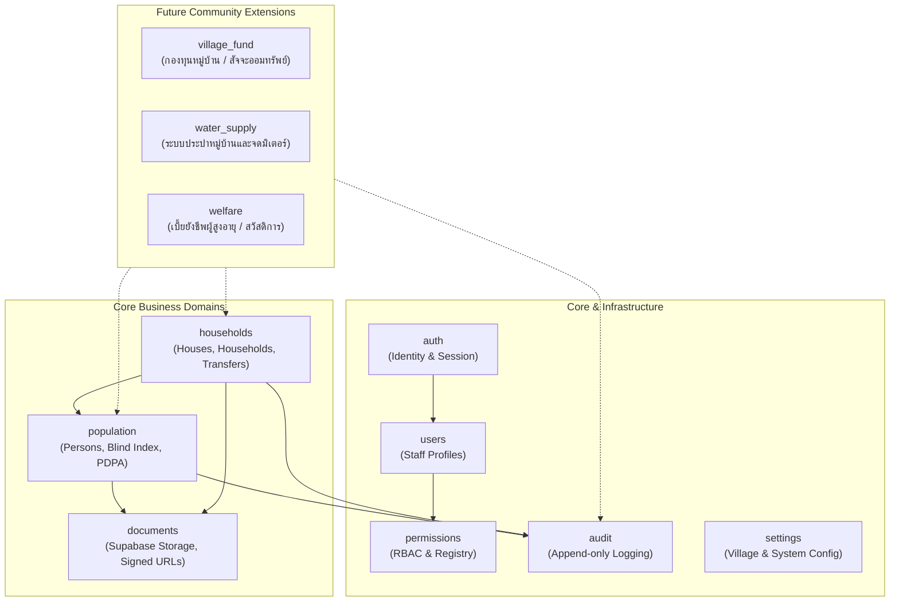

# ข้อกำหนดขอบเขตและการขยายโมดูล (Module Boundaries & Extension Guidelines)
## Smart Village Management System (VMS) — ระบบบริหารหมู่บ้านอัจฉริยะ

---

## 1. ขอบเขตความรับผิดชอบของแต่ละโมดูล (Module Responsibilities)

### 1.1 `modules/auth` (Authentication Domain)
- **ความรับผิดชอบ**: การจัดการเซสชัน, การเข้าสู่ระบบ/ออกจากระบบ, การต่ออายุ Session Token, การส่งอีเมลรีเซ็ตรหัสผ่าน, MFA TOTP Handshake
- **ไม่รับผิดชอบ**: การกำหนดสิทธิ์ทางธุรกิจ (เป็นหน้าที่ของ `permissions`)

### 1.2 `modules/users` (User Management Domain)
- **ความรับผิดชอบ**: การบันทึกและจัดการข้อมูลเจ้าหน้าที่ผู้ใช้งาน, การเปิด/ปิดสถานะบัญชี, การผูกโยงผู้ใช้กับหมู่บ้าน (`village_user_access`)

### 1.3 `modules/roles` (Roles & Dynamic RBAC Domain)
- **ตำแหน่งโค้ด**: `src/modules/roles` และ `src/lib/permissions.ts`
- **ความรับผิดชอบ**: ทะเบียนสิทธิ์ (Permission Registry), การจับคู่บทบาทกับสิทธิ์ (`role_permissions`), การตรวจสอบสิทธิ์ที่ Server (`assertPermission`)

### 1.4 `modules/population` (Population Domain)
- **ความรับผิดชอบ**: การบันทึก แก้ไข ค้นหา และเก็บถาวรข้อมูลประชากร, การเข้ารหัสเลขบัตรประชาชน (AES-256-GCM), การสร้างและจับคู่ Blind Index (HMAC-SHA256), การแสดงผลข้อมูลอ่อนไหวแบบ Masked
- **ความสัมพันธ์ภายนอก**: ติดต่อ `modules/documents` สำหรับเอกสารประจำตัว, บันทึกการเข้าดูข้อมูลอ่อนไหวผ่าน `modules/audit`

### 1.5 `modules/households` (House & Household Domain)
- **ความรับผิดชอบ**: การจัดการบ้านทางกายภาพ (Houses), การจัดตั้งครัวเรือน (Households), การเป็นสมาชิกครัวเรือน (Memberships), การย้ายเข้า/ออก/ย้ายระหว่างบ้าน (Transfers), การบันทึกประวัติเหตุการณ์ (`household_events`) ภายใต้ ACID Transactions

### 1.6 `modules/documents` (File & Document Domain)
- **ความรับผิดชอบ**: ติดต่อกับ Supabase Storage API, การสร้าง Temporary Pre-signed URLs, การตรวจสอบ MIME Type / Magic Bytes, การจัดการ Metadata และ Checksum ของไฟล์

### 1.7 `modules/audit` (Audit Logging Domain)
- **ความรับผิดชอบ**: การบันทึกประวัติการเปลี่ยนแปลงและเหตุการณ์ความปลอดภัย (Append-only Logger), การ Sanitize ข้อมูลไม่ให้มี Plaintext Secret หลุดเข้าไปใน Log

### 1.8 `modules/settings` (Settings Domain)
- **ความรับผิดชอบ**: ข้อมูลโปรไฟล์หมู่บ้าน, การตั้งค่านโยบายของระบบ

---

## 2. กฎการพึ่งพาและการสื่อสารระหว่างโมดูล (Dependency Rules)

1. **Rule of Clean Dependency (Unidirectional Flow)**: การเรียกใช้ต้องเป็นไปในทิศทางเดียว ห้ามเกิดวงวน (Circular Dependency)
2. **Repository Isolation**: `src/modules/A/repository.ts` สามารถเข้าถึงตารางที่โมดูล A เป็นเจ้าของเท่านั้น หากต้องการข้อมูลของโมดูล B ต้องเรียกผ่าน `src/modules/B/service.ts`
3. **Data Integrity via Shared Transactions**: ในกรณีที่การทำงานข้ามโมดูลต้องเสร็จสมบูรณ์พร้อมกัน (Atomic) เช่น การย้ายสมาชิกครัวเรือนที่กระทบทั้ง `households` และบันทึก `audit` ให้ส่ง Prisma Transaction Client (`tx`) เข้าไปใน Service Functions ที่เกี่ยวข้อง

---

## 3. แนวทางการเพิ่มโมดูลใหม่ในอนาคต (Extension Guidelines)

เมื่อต้องการเพิ่มระบบใหม่ เช่น **ระบบกองทุนหมู่บ้าน (Village Fund)** หรือ **ระบบประปาหมู่บ้าน (Water Supply)** สามารถดำเนินการตามขั้นตอนมาตรฐานดังนี้ โดยไม่ต้องแก้ไขโค้ดแกนหลักเดิม:

### ขั้นตอนที่ 1: เพิ่ม Schema ใน `prisma/schema.prisma`
- สร้างตารางใหม่ที่มี `village_id UUID NOT NULL REFERENCES villages(id)`
- อ้างอิงบุคคลผ่าน `person_id UUID REFERENCES persons(id)` หรือบ้านผ่าน `house_id UUID REFERENCES houses(id)`
- รัน `prisma migrate dev --name add_village_fund_module`

### ขั้นตอนที่ 2: สร้างโมดูลใหม่ใน `src/modules/<new-module>/`
- สร้างโครงสร้างมาตรฐาน:
  - `types.ts`
  - `schemas.ts` (Zod validation)
  - `repository.ts`
  - `service.ts`
  - `actions.ts`

### ขั้นตอนที่ 3: ลงทะเบียนรหัสสิทธิ์ใหม่ (Permission Registration)
- เพิ่มรหัสสิทธิ์ใหม่ใน `permissions` seed เช่น:
  - `fund.account.read`
  - `fund.transaction.create`
  - `water.meter.record`
- มอบหมายสิทธิ์ให้ Role ที่เกี่ยวข้องในระบบ

### ขั้นตอนที่ 4: สร้างหน้าจอใน `src/app/(dashboard)/<new-module>/`
- เชื่อมต่อ Server Actions จากโมดูลใหม่ และใช้ UI Components จาก `src/components/ui/`
