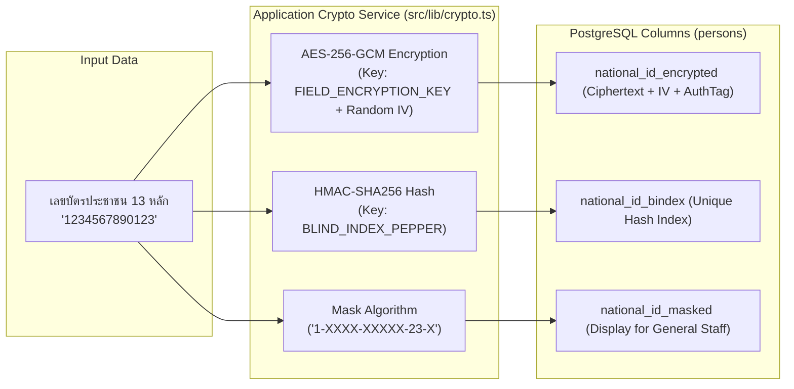

# สถาปัตยกรรมความมั่นคงปลอดภัยและการคุ้มครองข้อมูลส่วนบุคคล (Security & Privacy Architecture)
## Smart Village Management System (VMS) — ตามแนวทาง Security by Design & PDPA

---

## 1. แบบจำลองภัยคุกคาม (Threat Model — STRIDE Analysis)

| ภัยคุกคาม (STRIDE) | ความเสี่ยงในบริบท VMS | มาตรการป้องกันเชิงรุก (Mitigation Strategy) |
|:---|:---|:---|
| **Spoofing (การปลอมแปลงตัวตน)** | ผู้ไม่หวังดีแอบอ้างเป็นเจ้าหน้าที่เพื่อเข้าดูข้อมูลประชากร | บังคับใช้ Supabase Auth, Secure HttpOnly SameSite=Strict Cookies, Session Inactivity Timeout, และรองรับ MFA (TOTP) |
| **Tampering (การแก้ไขข้อมูลโดยมิชอบ)** | การแอบแก้ไขสิทธิ์ผู้ใช้, แก้ไขทะเบียนบ้าน หรือแก้ไขประวัติการย้าย | บังคับใช้ Database Constraints, Database Transactions, ป้องกัน Tampering ในระดับ Server ด้วย RBAC Guard, ตรวจสอบ Checksum ไฟล์เอกสาร |
| **Repudiation (การปฏิเสธความรับผิด)** | เจ้าหน้าที่ปฏิเสธว่าไม่ได้เป็นผู้ลบหรือแก้ไขข้อมูลประชากร | บังคับใช้ Append-Only `audit_logs` บันทึก User ID, IP, Action, Entity, Timestamp และไม่อนุญาตให้มีสิทธิ์แก้ไข/ลบ Log ในระบบ |
| **Information Disclosure (ข้อมูลรั่วไหล)** | ฐานข้อมูลหรือไฟล์หลุด หรือพนักงานทั่วไปแอบดูเลขบัตรประชาชน | เข้ารหัส Field-Level AES-256-GCM, ทำ Blind Index, ซ่อนเลขบัตรด้วย Masking, บังคับใช้ Private Storage Bucket และเข้าถึงผ่าน Signed URL อายุ 60 วินาที |
| **Denial of Service (การทำให้ระบบหยุดทำงาน)** | ยิงคำขอซ้ำ ๆ เพื่อให้เซิร์ฟเวอร์หรือฐานข้อมูลล่ม | ติดตั้ง Rate Limiting ที่ Next.js Middleware และ Reverse Proxy, ควบคุม Connection Pool ของ PostgreSQL, จำกัดขนาดไฟล์อัปโหลด |
| **Elevation of Privilege (การยกระดับสิทธิ์)** | ผู้ใช้ระดับ Staff พยายามเข้าถึง API ของ System Admin | ตรวจสอบสิทธิ์ที่ Server ทุกฟังก์ชัน (Deny by Default), ใช้ Zod Schema ป้องกัน Mass Assignment, มีระบบตรวจจับ Privilege Escalation |

---

## 2. การควบคุมความปลอดภัยด้านการยืนยันตัวตน (Authentication Security)

1. **Identity Management**: บริหารจัดการบัญชีผ่าน Supabase GoTrue Engine ไม่มีการพัฒนาโค้ด Hash รหัสผ่านเองในระดับแอปพลิเคชัน
2. **Session Storage & Transport**:
   - จัดเก็บ Session Tokens ใน **HttpOnly**, **Secure**, **SameSite=Strict** Cookies เท่านั้น
   - JavaScript ในเบราว์เซอร์ไม่สามารถเข้าถึงคุกกี้ได้ (ป้องกันการถูกขโมยผ่าน XSS)
3. **Session Lifetime & Expiration**:
   - Access Token อายุไม่เกิน 15 นาที
   - Sliding Inactivity Timeout: หากไม่มีการใช้งานเกิน 30 นาที บังคับ Re-authenticate
   - Absolute Session Timeout: เซสชันจะหมดอายุแน่นอนภายใน 12 ชั่วโมง
4. **Brute Force & Account Lockout**:
   - ตรวจจับความพยายามล็อกอินผิดพลาดติดต่อกัน 5 ครั้งภายใน 15 นาที
   - ล็อกการพยายามล็อกอินจาก IP นั้นเป็นเวลา 15 นาที และบันทึกลง `security_events`
5. **Multi-Factor Authentication (MFA)**:
   - บังคับใช้ TOTP (Time-based One-Time Password) ผ่าน Google Authenticator สำหรับบทบาท `SYSTEM_ADMIN` และ `VILLAGE_ADMIN`

---

## 3. สถาปัตยกรรมสิทธิ์และการแบ่งแยกข้อมูลหมู่บ้าน (Authorization & Tenant Isolation)

1. **หลักการ Deny by Default**: ทุก Server Action และ Route Handler จะปฏิเสธคำขอทันที เว้นแต่จะผ่านการตรวจสอบสิทธิ์ว่าผู้ใช้มี Session ที่ถูกต้องและมีสิทธิ์ในบทบาทนั้น
2. **ป้องกัน Cross-Village Data Leakage (Multi-Village Isolation)**:
   - Prisma Client Extension จะตรวจสอบบริบท `activeVillageId` ของผู้ใช้ปัจจุบัน
   - ในทุกคำสั่งอ่านและเขียนข้อมูลประชากร/ครัวเรือน Prisma Extension จะแทรกเงื่อนไข `{ villageId: session.villageId }` โดยอัตโนมัติ
   - ป้องกันข้อผิดพลาดที่โปรแกรมเมอร์อาจลืมระบุ Village Filter
3. **ป้องกัน IDOR (Insecure Direct Object Reference)**:
   - เมื่อผู้ใช้ส่ง `id` บุคคลหรือบ้านเข้ามา ระบบจะตรวจสอบว่า `entity.village_id == session.villageId` หรือไม่ ก่อนส่งข้อมูลหรืออนุญาตให้แก้ไข

---

## 4. ยุทธศาสตร์การเข้ารหัสข้อมูลและการจัดการคีย์ (Field-Level Encryption & Key Management)

### รายละเอียดทางเทคนิค:
1. **AES-256-GCM (Authenticated Encryption)**:
   - รับประกันทั้ง **ความลับ (Confidentiality)** และ **ความถูกต้องไม่ถูกแก้ไข (Integrity)**
   - สุ่ม Initialization Vector (IV) ขนาด 12 ไบต์ใหม่ทุกครั้งที่มีการเข้ารหัส ทำให้การเข้ารหัสเลขเดิมจะได้ Ciphertext ต่างกันเสมอ
2. **Blind Index (HMAC-SHA256)**:
   - เพื่อแก้ปัญหาการค้นหา Exact Match โดยไม่ต้องถอดรหัสทั้งตาราง
   - คำนวณแฮชด้วย `HMAC-SHA256(Raw_ID, BLIND_INDEX_PEPPER)`
   - เก็บค่าแฮชลงในคอลัมน์ `national_id_bindex` พร้อมสร้าง Unique B-Tree Index
3. **Key Separation & Secret Management**:
   - `FIELD_ENCRYPTION_KEY`: คีย์สำหรับถอดรหัส/เข้ารหัส AES-256
   - `BLIND_INDEX_PEPPER`: คีย์ลับสำหรับสร้างแฮช
   - เก็บใน Environment Variables (`.env.production`) ที่ถูกจำกัดสิทธิ์ในระบบปฏิบัติการ VPS (`chmod 600`) ห้าม Commit ลง Git Repository เด็ดขาด

### 4.1 ระบบยืนยันความปลอดภัย 2 ชั้น (Security PIN 6 หลัก) สำหรับการเปิดดูข้อมูลอ่อนไหว (Sensitive Data Reveal)
1. **การยืนยันรหัส PIN 6 หลักส่วนบุคคล (Personal Security PIN)**:
   - ผู้ใช้งานแต่ละคนสามารถตั้งค่าและเปลี่ยนรหัส PIN 6 หลักส่วนตัวได้ที่ `/settings/security` หรือตั้งค่าครั้งแรกเมื่อขอเปิดดูข้อมูล
   - **การจัดเก็บข้อมูลระดับผู้ใช้ (Per-User Storage)**: จัดเก็บแยกตามตัวตนของผู้ใช้แต่ละรายโดยตรงในตาราง `users` (`security_pin_hash`, `security_pin_salt`, `pin_failed_attempts`, `pin_locked_until`) ทำให้เป็นของใครของมันอย่างแท้จริง และอิสระจากบริบทหมู่บ้านที่เลือกทำงาน
   - **อัลกอริทึมการเข้ารหัส**: ใช้ **PBKDF2-HMAC-SHA512** (100,000 Rounds) ร่วมกับ Salt สุ่มระดับความปลอดภัยสูง (32-byte per user) และ Server Pepper
   - **Timing-Safe Comparison**: ตรวจสอบรหัสแบบ Constant-time (`crypto.timingSafeEqual`) ป้องกันการโจมตีผ่าน Timing Attack
   - **มาตรการป้องกัน Brute-Force (Online Throttling)**: หากกรอก PIN ผิดติดต่อกัน 5 ครั้ง ระบบจะระงับการตรวจสอบ PIN ชั่วคราว 15 นาที และบันทึก Security Event ลงใน Audit Trail
2. **การระบุวัตถุประสงค์ตาม PDPA**:
   - หลังผ่านการยืนยัน PIN เจ้าหน้าที่ต้องระบุวัตถุประสงค์ความจำเป็นก่อนที่ระบบจะถอดรหัสแบบ On-demand และบันทึก Audit Log ทุกครั้ง

---

## 5. ความปลอดภัยในการจัดเก็บไฟล์ (Storage Security)

1. **Private Buckets Only**: Bucket `village-documents` บน Supabase Storage ถูกกำหนดเป็น Private โดยสมบูรณ์ ห้ามเปิด Public Read
2. **UUID File Naming**:
   - ชื่อไฟล์บน Storage จะเป็น UUID v4 เช่น `/villages/{village_id}/{file_uuid}`
   - ไม่ปรากฏชื่อบุคคล, เลขบัตรประชาชน หรือชื่อไฟล์จริงบน Path ของดิสก์
3. **MIME Type & Magic Bytes Verification**:
   - ตรวจสอบ Content Header และอ่าน Magic Bytes (Binary Signature) ต้นไฟล์ก่อนอนุญาตให้อัปโหลด
   - อนุญาตเฉพาะ: `application/pdf`, `image/jpeg`, `image/png`
   - ปฏิเสธไฟล์ประเภท Executable, Script (.exe, .sh, .bat, .php, .js, .html)
4. **Short-Lived Signed URLs**:
   - การเปิดดูหรือดาวน์โหลดไฟล์ จะทำผ่านการสร้าง Pre-signed URL ที่มีอายุเพียง **60 วินาที**
   - การขอ Signed URL ต้องผ่านการตรวจสอบสิทธิ์ `document.read` ของผู้ใช้ก่อนเสมอ

---

## 6. การปฏิบัติตาม พ.ร.บ. คุ้มครองข้อมูลส่วนบุคคล (PDPA Compliance)

- **Data Minimization**: จัดเก็บเฉพาะข้อมูลประชากรที่จำเป็นต่อการบริหารงานทะเบียนและบริการชุมชนเท่านั้น
- **Purpose Limitation**: ห้ามนำข้อมูลประชากรไปใช้งานนอกเหนือจากภารกิจงานพัฒนาหมู่บ้านและชุมชน
- **Storage Limitation & Archival**: เมื่อประชากรย้ายออกจากหมู่บ้านหรือเสียชีวิต ข้อมูลจะไม่ถูกลบทำลายทันทีเพื่อประโยชน์ทางประวัติศาสตร์และสถิติ แต่จะถูกทำเครื่องหมายเป็น `is_archived = true` และจำกัดการเข้าถึง
- **Sensitive Access Audit**: เจ้าหน้าที่ทั่วไปจะมองเห็นเฉพาะเลขบัตรแบบ Mask หากจำเป็นต้องดูเลขตัวเต็ม ระบบจะมีปุ่ม "แสดงเลขเต็ม" ซึ่งจะแสดงกล่องยืนยันเหตุผล และส่งคำขอไปบันทึกลง `audit_logs` พร้อม Alert ไปยังผู้ดูแลระบบ
- **Right to Rectification**: มีกระบวนการให้เจ้าหน้าที่สามารถแก้ไขข้อมูลที่ผิดพลาดได้ พร้อมบันทึกประวัติการเปลี่ยนแปลง (Audit Trail)
